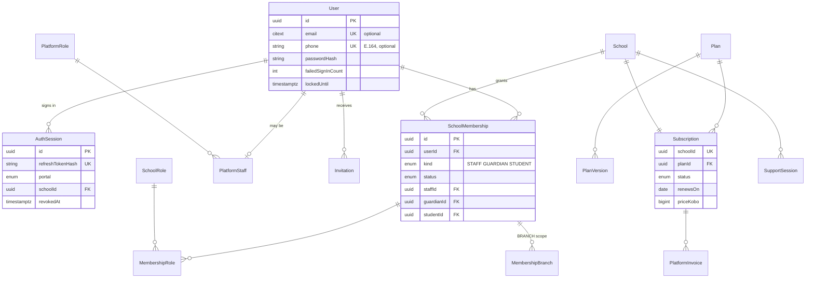
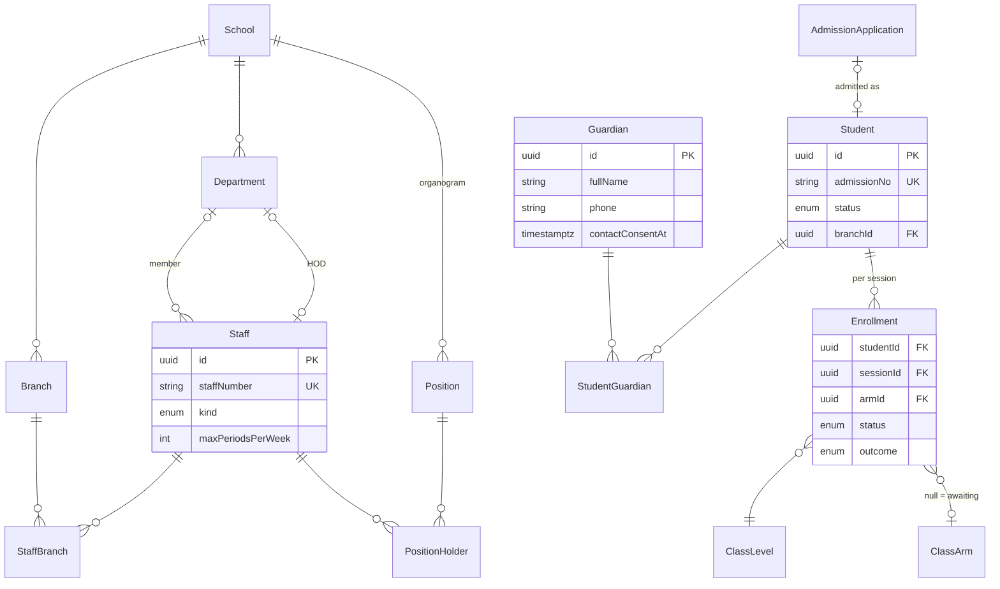
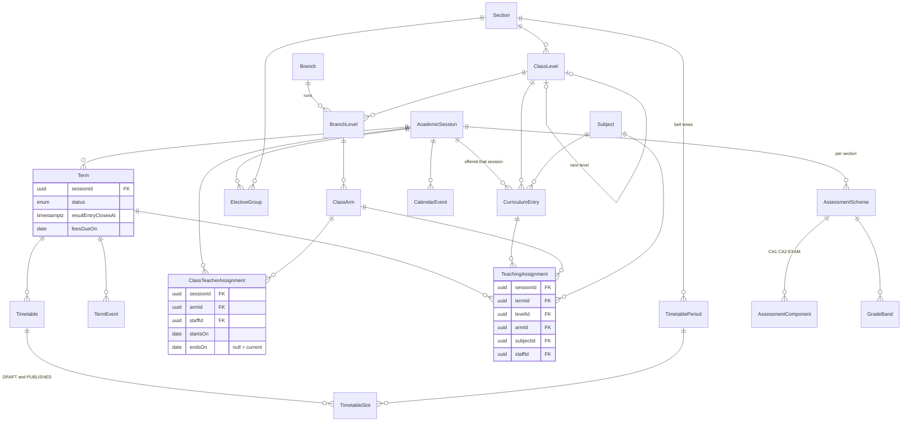
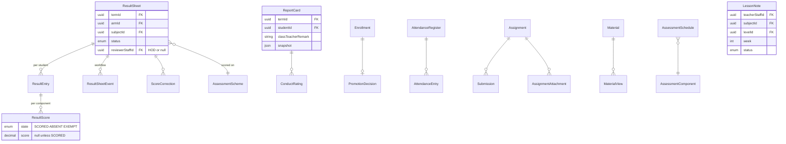
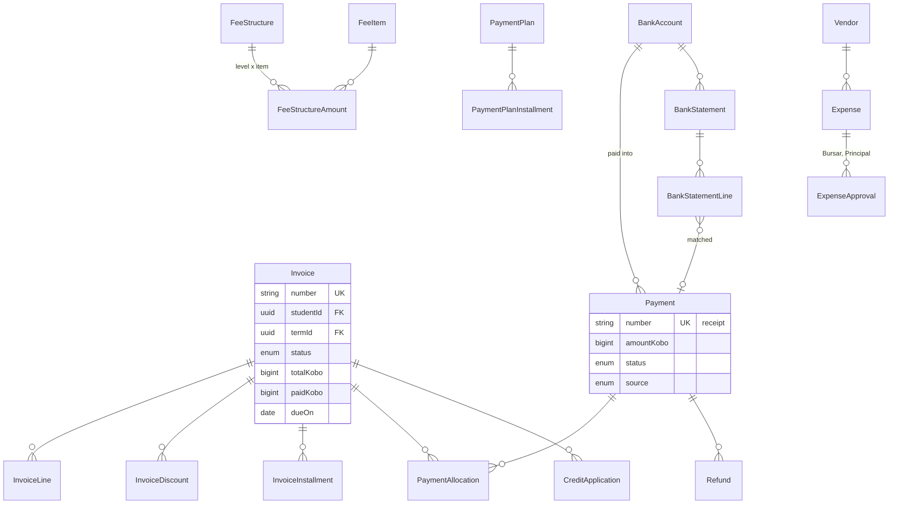
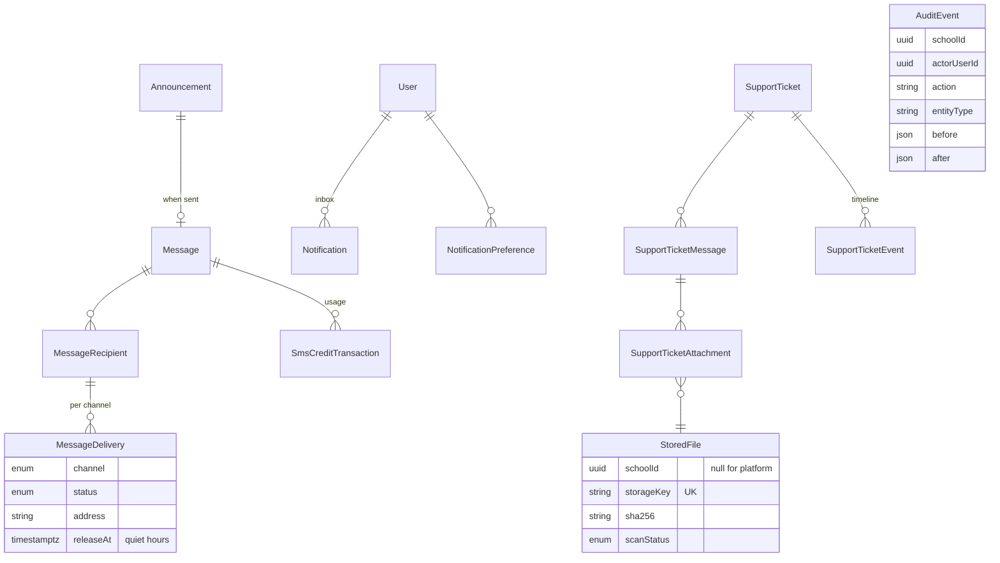

# EduTrack data model

Status: initial design, 13 Nov 2026. Source of truth: `services/edutrack/backend/prisma/schema/*.prisma` and the `init` migration. Requirements came from the three built portals (their types, mock databases and handlers) and `docs/teacher-workspace-spec.md`.

- PostgreSQL 18, Prisma 7 (`prisma-client` generator, ESM, output `src/generated/prisma`, git-ignored).
- 122 models, 103 enums, 123 tables including `_prisma_migrations`.
- Migrations: `20261113102730_init`, `20261113130000_sign_in_by_phone`, `20261113150000_product_answers` (the product owner's answers of 13 Nov 2026, below).
- Multi-file schema, one file per domain:

| File                   | Models | What it holds                                                                                                           |
| ---------------------- | -----: | ----------------------------------------------------------------------------------------------------------------------- |
| `_base.prisma`         |      — | Generator, datasource, `citext` extension, conventions                                                                  |
| `identity.prisma`      |      8 | User, sessions, reset tokens, invitations, school memberships, school roles                                             |
| `platform.prisma`      |     10 | Platform staff and roles, plans and versions, subscriptions, platform invoices, support sessions, platform sequences    |
| `school.prisma`        |     11 | School (tenant), settings, branches, departments, organogram, setup checklist, number sequences                         |
| `people.prisma`        |     10 | Staff, students, guardians, documents, admissions, enrollments                                                          |
| `academics.prisma`     |     22 | Sections, sessions, terms, calendar, levels, branch levels, arms, subjects, curriculum, assignments, timetable, schemes |
| `results.prisma`       |     10 | Result sheets and workflow, scores, corrections, publication, report cards, promotion                                   |
| `attendance.prisma`    |      2 | Daily register and marks                                                                                                |
| `teaching.prisma`      |      8 | Assignments, submissions, materials, assessment schedules, lesson notes                                                 |
| `finance.prisma`       |     23 | Fees, invoices, payments, credit, refunds, accounts, statements, expenses, vendors                                      |
| `communication.prisma` |     12 | Announcements, messages, deliveries, templates, SMS credit, notifications, preferences                                  |
| `support.prisma`       |      4 | Support tickets, messages, attachments, timeline                                                                        |
| `files.prisma`         |      1 | StoredFile                                                                                                              |
| `audit.prisma`         |      1 | AuditEvent                                                                                                              |

## Conventions

| Topic         | Rule                                                                                                                                                                                                                                                                                                                                                              |
| ------------- | ----------------------------------------------------------------------------------------------------------------------------------------------------------------------------------------------------------------------------------------------------------------------------------------------------------------------------------------------------------------- |
| Names         | Models PascalCase singular, fields camelCase. Tables snake_case plural (`result_sheets`), columns snake_case, enum types snake_case. Settings rows keep the plural noun (`SchoolSettings` → `school_settings`).                                                                                                                                                   |
| IDs           | `String @id @default(uuid(7)) @db.Uuid`, generated by Prisma. Pure join tables (`membership_roles`, `staff_branches`…) use a composite primary key instead of a surrogate id.                                                                                                                                                                                     |
| Human numbers | Admission, staff, invoice, receipt, refund, expense, transfer and application numbers are per-school unique columns, filled from `NumberSequence` (school × kind × scope → next value) and the school's pattern (`SchoolSettings`, `FinanceSettings`). Support ticket numbers (SUP-1042) and platform invoice numbers are platform-wide, from `PlatformSequence`. |
| Money         | Integer kobo in `BigInt` columns named `*Kobo`. Percentages are basis points (`*Bp`, 10000 = 100%). Currency only where it varies (`PlatformInvoice`, `School.currency`).                                                                                                                                                                                         |
| Scores        | `Decimal(5,2)`. ABS and EXM are `ScoreState` values with a null score; a missing score has no row.                                                                                                                                                                                                                                                                |
| Time          | `Timestamptz(3)` for instants, `Date` for calendar days (due dates, register days, term dates), `Time(0)` for bell times and quiet hours.                                                                                                                                                                                                                         |
| Bookkeeping   | `createdAt` and `updatedAt` on every table except append-only logs (`AuditEvent`, `ResultSheetEvent`, `SupportTicketEvent`, `SmsCreditTransaction`, `PlanVersion`), which only get `createdAt` because they are never updated.                                                                                                                                    |
| Soft delete   | `deletedAt` only where restore is needed: `User`, `Student`, `Guardian`, `StaffDocument`, `StudentDocument`, `StoredFile`. Other "removal" is a status (`archivedAt`, `INACTIVE`, `DEACTIVATED`, `ARCHIVED`).                                                                                                                                                     |
| Enums         | One value per UI word, mechanically: `'Under review'` ↔ `UNDER_REVIEW`, `'In-app'` ↔ `IN_APP`, `'fee.reminder'` ↔ `FEE_REMINDER`. The API maps both ways; the database stores the enum name. Derived words (Overdue, Expired, Not created, Not written) are not stored.                                                                                           |
| Actor columns | `*ById` columns that record who clicked (approvedById, verifiedById…) are plain user ids with no foreign key. Users are never hard-deleted and `AuditEvent` keeps names. Columns that drive behaviour (teacher, reviewer, assignee, requester) are real foreign keys.                                                                                             |

## Decisions

### Given

1. One database, shared schema, `schoolId` on every school-owned row with a leading `schoolId` index; uniqueness scoped per school.
2. School Admin is one shared portal (school chosen at sign-in). Teacher, Parent and Student portals share **one subdomain per school** with a path per portal: `greenfield.edutrack.ng/teacher`, `/parent`, `/student`. `School.slug` is that subdomain (citext, unique, format checked in the database; reserved words blocked in app code). There are no per-portal domains; `customDomain` is an optional replacement for the subdomain, later.
3. In-house auth: one global `User` who signs in with an email (citext) **or** a phone number (E.164, unique) — many guardians only have a phone, so email is optional; pupils sign in with their admission number on their school's subdomain through their STUDENT membership. Invitations go by email, SMS or both (CHECK: at least one). argon2id `passwordHash`, rotating hashed refresh tokens in `AuthSession`, `PasswordResetToken`, `Invitation`, lockout counters, `passwordChangedAt`/`mustChangePassword`, TOTP fields. School access is `SchoolMembership`; platform access is `PlatformStaff`.
4. NDPR basics only: guardian contact consent, an SMS fee-reminder opt-out, an email opt-out for non-essential messages, and tiered retention (see Retention).
5. UUIDv7 ids; human numbers from `NumberSequence`.
6. Kobo `BigInt`; score states as enums.
7. `timestamptz`/`date`, timestamps everywhere, soft delete where restore exists.
8. One `StoredFile` table referenced by every attachment.
9. Generic `AuditEvent` plus purpose-built histories where justified (below).
10. Enums for closed sets.
11. Explicit `onDelete` on every relation.
12. Multi-file schema; `prisma.config.ts` points at `prisma/schema`.

### Made here

| Decision                                                                                                                                                                                                                                                                                                                                                      | Why                                                                                                                                                                                                                        |
| ------------------------------------------------------------------------------------------------------------------------------------------------------------------------------------------------------------------------------------------------------------------------------------------------------------------------------------------------------------- | -------------------------------------------------------------------------------------------------------------------------------------------------------------------------------------------------------------------------- |
| **Composite tenant foreign keys.** Every school-owned → school-owned relation is `(school_id, x_id) → (school_id, id)`; referenced models carry `@@unique([schoolId, id])`.                                                                                                                                                                                   | The database itself refuses a row that points into another school. Foreign-key checks bypass RLS, so RLS alone would not catch this. Cost: one extra unique index per referenced table.                                    |
| `SchoolMembership.kind` = STAFF / GUARDIAN / STUDENT, unique per (school, user, kind), linked to the `Staff`/`Guardian`/`Student` record.                                                                                                                                                                                                                     | One place answers "can this user use this school's portal, and as whom"; a teacher who is also a parent at the same school gets two memberships. A check constraint keeps kind and link consistent.                        |
| School roles are per-school rows (predefined ones copied at provisioning with a stable `key`), permissions as JSON (module → actions).                                                                                                                                                                                                                        | Matches the role editor; real foreign keys from memberships and positions; app checks use `key` (teacher, hod, academic_head, bursar…).                                                                                    |
| Invite = create `User` (no password) + `SchoolMembership`/`PlatformStaff` in INVITED + `Invitation`.                                                                                                                                                                                                                                                          | The Users screens list invited people with their roles before they accept.                                                                                                                                                 |
| School status split: `School.status` (ONBOARDING, ACTIVE, SUSPENDED) and `Subscription.status` (ACTIVE, EXPIRING, GRACE_PERIOD, RESTRICTED, EXPIRED, CANCELLED).                                                                                                                                                                                              | The back office's eight words mix two lifecycles. Displayed status = school status if onboarding/suspended, else subscription status. A daily job moves EXPIRING/EXPIRED.                                                  |
| One `Subscription` row per school; changes are `AuditEvent`s; revenue comes from `PlatformInvoice.kind`.                                                                                                                                                                                                                                                      | The UI shows only the current subscription; renewals/new/upgrades on the revenue chart are invoice kinds.                                                                                                                  |
| **Structure is school-wide; offerings and history are per session/term.** `ClassLevel` is one school-wide list (section, order, next level); each branch picks the levels it runs (`BranchLevel`); `ClassArm` is branch × level and its foreign key to `BranchLevel` means an arm can only exist for a level the branch runs; arms are archived, not deleted. | Promotion and curriculum key on the level ("JSS 2"), not a branch. Enrollments, class teachers, teaching assignments, timetables, sheets and schemes carry the session/term, so changing structure never rewrites history. |
| `Enrollment` (student × session → branch, level, nullable arm).                                                                                                                                                                                                                                                                                               | "Admitted, awaiting placement" is an enrollment with no arm; the student's class history is these rows; promotion closes one and opens the next.                                                                           |
| `ClassTeacherAssignment` per session with `startsOn`/`endsOn` (one current per session × arm); `TeachingAssignment` per term (unique term × arm × subject).                                                                                                                                                                                                   | Class teacher is a session role in Nigerian schools; the admin's "copy from previous term" works on teaching assignments.                                                                                                  |
| `AssessmentScheme` per session × section with component rows (`key` CA1/CA2/EXAM), grade bands and descriptive ratings; `lockedAt` once a sheet publishes.                                                                                                                                                                                                    | Published results keep the scheme they were scored on. Pass mark and rounding live on the scheme for the same reason; `showPosition` stays a school setting.                                                               |
| Scores: `ResultEntry` (sheet × student: cached total, grade, teacher remark) and `ResultScore` (entry × component: state + nullable score).                                                                                                                                                                                                                   | "Missing is never zero" falls out of the shape; totals are cached for reports, rankings and promotion.                                                                                                                     |
| `ReportCard.snapshot` (JSON) frozen at publish, plus remark and `ConductRating` rows while open.                                                                                                                                                                                                                                                              | What parents saw must not change when a sheet is later corrected; republishing bumps `version`.                                                                                                                            |
| Timetable slots carry a `layer` (DRAFT/PUBLISHED).                                                                                                                                                                                                                                                                                                            | Admins edit a draft while the portals read the published grid; "my week" stays a plain indexed query.                                                                                                                      |
| Invoice money columns (`subtotalKobo`, `discountKobo`, `totalKobo`, `paidKobo`) and `CommunicationSettings.smsBalanceUnits` are denormalised.                                                                                                                                                                                                                 | Lists and filters need them. They are updated in the same transaction as the rows they summarise; check constraints keep `0 ≤ paid ≤ total`. Student credit and account balances stay computed.                            |
| `InvoiceStatus` stores DRAFT, ISSUED, PARTIALLY_PAID, PAID, CANCELLED; Overdue is computed.                                                                                                                                                                                                                                                                   | Overdue changes with the clock; the rest change with writes.                                                                                                                                                               |
| Support: one ticket table for both portals, with the school's `topic` and the desk's `category`; desk statuses stored, school view mapped.                                                                                                                                                                                                                    | School Admin and the back office show the same ticket with different vocabularies.                                                                                                                                         |
| `SupportSession` model.                                                                                                                                                                                                                                                                                                                                       | Platform staff read-only access to a school bypasses tenant isolation, so it must be explicit, time-boxed and referenced from every audited request (`AuditEvent.supportSessionId`).                                       |
| Purpose-built histories: `ResultSheetEvent`, `SupportTicketEvent`. Everything else uses `AuditEvent`.                                                                                                                                                                                                                                                         | Sheet events are queried (an HOD's "recently decided", returned-by details); ticket events need a per-event `visibleToSchool` flag. Settings change history is `AuditEvent` filtered by `area`.                            |
| `partialIndexes` and `postgresqlExtensions` preview features.                                                                                                                                                                                                                                                                                                 | Partial unique indexes express "one open X" rules in the database; `citext` gives case-insensitive emails and slugs.                                                                                                       |
| CHECK constraints appended to the migrations (47 in total: 40 in `init`, 3 in `sign_in_by_phone`, 4 in `product_answers`).                                                                                                                                                                                                                                    | Prisma can't express them; Migrate ignores CHECKs when diffing, so later migrations leave them alone.                                                                                                                      |

## Tenant isolation

Three layers, cheapest to strongest:

1. **Composite foreign keys (now).** A row can only reference rows of its own school (see above). `School` itself, users, platform tables and `PublicHoliday` are the only rows without `school_id`; `StoredFile`, `AuditEvent`, `AuthSession`, `Invitation`, `Notification` and `NotificationPreference` have a nullable `school_id` because some rows belong to the platform.
2. **Prisma client extension (built: `TenantPrismaService`, see [conventions.md](conventions.md#tenant-isolation)).** A request-scoped tenant context (`AsyncLocalStorage`: `schoolId`, `userId`, `supportSessionId`, `requestId`) set by the auth guard from the session's school. A `$extends` query extension, for every model with `schoolId`: injects `schoolId` into `where` of reads/updates/deletes (including `findUnique`, by rewriting to the compound `schoolId_id` key), sets it on creates and refuses a create whose `schoolId` differs, and throws if no tenant context exists (jobs must state a school or opt in to a platform-wide context explicitly). The platform back office uses an unscoped client that only platform guards can obtain.
3. **Row Level Security (later migration).** `ALTER TABLE … ENABLE ROW LEVEL SECURITY` and a policy per school-owned table, `USING (school_id = current_setting('app.school_id')::uuid)` (plus `school_id IS NULL` where platform rows exist), with `FORCE ROW LEVEL SECURITY`. The app connects as a non-owner role; each transaction runs `SELECT set_config('app.school_id', $1, true)` (the extension wraps queries in a transaction that sets it). Platform work uses a separate role with `BYPASSRLS`. Because every table has its own `school_id`, policies never need joins.

Notes for whoever builds layer 2: Prisma lists the partial unique keys (e.g. `studentId_termId` on `Invoice`) in `WhereUniqueInput`; they are only unique among live rows, so query them with `findFirst` and a status filter, never `findUnique`.

## Integrity rules

Enforced by the database:

- Uniques per school: admission no, staff no, invoice/receipt/refund/expense/transfer/application numbers (ticket numbers are unique platform-wide), branch code and name, section code and name, level name, subject code, role name and key, fee item, discount, plan, vendor, bank account and expense-category names, session name.
- Structural uniques: one sheet per term × arm × subject; one register per arm × day; one mark per register × student; one assessment schedule per term × arm × subject × component; one lesson note per term × teacher × subject × level × week; one teaching assignment per term × arm × subject; one branch-level row per branch × level; one curriculum entry per session × level × subject and one elective group name per session × section; one bell period per section × order; one timetable per term × arm and one slot per timetable × layer × day × period; one scheme per session × section; one fee structure per term × branch and one amount per structure × level × item; one enrollment per student × session; one report card per term × student and one rating per card × trait; one result publication per term × arm; one submission per assignment × student; one view row per material × student; one reminder per sheet × day; one promotion decision per enrollment; one membership per school × user × kind; one event setting / template per school × event (× channel); one subscription per school.
- Partial uniques: one ACTIVE session and one ACTIVE term per school; one current (no `endsOn`) class teacher per session × arm; one open (UNDER_REVIEW) correction per sheet × student × component; one live (not cancelled) TERM_FEES invoice per student × term (AD_HOC invoices are unlimited); one primary guardian per student; one default payment plan per school; one live document per student × key; notification preferences unique per user × school × event and per user × event for platform rows.
- Composite foreign keys beyond tenancy: an arm's (branch, level) must be a `BranchLevel`; a teaching assignment's and a result sheet's (session, level, subject) must be a `CurriculumEntry` of that session, their term must belong to that session and their arm to that level.
- Checks: slug format; E.164 phone numbers and invitation destination (sign-in-by-phone migration); class-teacher `endsOn ≥ startsOn`; AD_HOC invoices need a title; membership kind ↔ linked record; date ranges (sessions, terms, events, periods); score state ↔ score, totals 0–100, weights 0–100, grade band min ≤ max, conduct and ticket ratings 1–5, assignment max score 1–100; money non-negative everywhere and strictly positive for payments, allocations, credit applications, refunds, transfers and expenses; `0 ≤ paid ≤ total` on invoices; transfer accounts differ; percentage discounts ≤ 100%; installment shares 1–10000 bp; material has exactly a file or a link; assignment attachment is exactly a file or a material.
- `onDelete`: Restrict for every academic, financial and people record; Cascade only for pure children (invoice lines/discounts/installments, ticket attachments, slots, scores within an entry, join rows, settings rows of a school, a user's sessions/tokens/notifications).

Left to the application (needs other rows, the clock, or configuration):

- Weights of a scheme sum to 100; installment shares sum to 10000; grade bands don't overlap.
- Status transitions (sheet workflow, HOD routing, ticket desk, invoice, refund and expense approval chains, announcement lifecycle).
- Term lock, result-entry deadline, register edit window (today + 5 school days), "no school" days.
- Teacher scope (only own assignments), the HOD can't review own work, one reminder per day (the unique key backs it).
- Capacity of arms, plan limits (students, branches, users, storage), SMS credit sufficiency.
- Session/term date overlap, terms inside their session; class-teacher date ranges don't overlap within a session × arm.
- A timetable uses the bell periods of its arm's section; promotion past a branch's last level moves the student to a branch that runs the next level, or graduates them.
- Students' elective choices come from that session's elective groups.
- Can't reduce an assignment's max score below a given score; corrections only on numeric published scores.
- Totals on invoices equal their lines (maintained in one transaction).

## Domain diagrams

Key fields only. `school_id` is on every school-owned table and omitted below.

### Identity and platform

### School, people and enrollment

### Academics

### Results, attendance and teaching

### Finance

### Communication, support, files and audit

## Screens → tables

### Platform back office

| Screens                      | Tables                                                                                    |
| ---------------------------- | ----------------------------------------------------------------------------------------- |
| Sign-in, invitation, profile | `User`, `AuthSession`, `PasswordResetToken`, `Invitation`, `PlatformStaff`                |
| Schools, provisioning        | `School`, `Branch`, `Section`, `Subscription`, `Invitation` + `SchoolMembership` (admins) |
| Subscriptions, plans         | `Subscription`, `Plan`, `PlanVersion`, `PlatformInvoice`, `AuditEvent`                    |
| Users and roles              | `PlatformStaff`, `PlatformRole`, `Invitation`, `AuthSession`                              |
| Support desk                 | `SupportTicket` + messages, attachments, events; `SupportSession`                         |
| Activity, audit              | `AuditEvent`                                                                              |
| Settings, notifications      | `PlatformSetting`, `NotificationPreference`, `Notification`                               |

### School Admin

| Screens                          | Tables                                                                                                                                      |
| -------------------------------- | ------------------------------------------------------------------------------------------------------------------------------------------- |
| Context bar, setup center        | `Branch`, `AcademicSession`, `Term`, `SetupStepState`                                                                                       |
| School profile, branches         | `School`, `Branch`, `BranchSection`                                                                                                         |
| Organogram, users, roles         | `Position`, `PositionHolder`, `PositionSuggestedRole`, `SchoolMembership`, `MembershipRole`, `MembershipBranch`, `SchoolRole`, `Invitation` |
| Staff directory, import          | `Staff`, `StaffBranch`, `StaffQualification`, `StaffDocument`, `ImportBatch`                                                                |
| Students, admissions, enrollment | `Student`, `StudentDocument`, `AdmissionApplication`, `Enrollment`, `StudentSubject`, `ImportBatch`                                         |
| Parents                          | `Guardian`, `StudentGuardian`, `SchoolMembership` (GUARDIAN)                                                                                |
| Sections, sessions, calendar     | `Section`, `AcademicSession`, `Term`, `TermEvent`, `CalendarEvent`, `PublicHoliday`                                                         |
| Classes, subjects, curriculum    | `ClassLevel`, `BranchLevel`, `ClassArm`, `ClassTeacherAssignment`, `Subject`, `Department`, `CurriculumEntry`, `ElectiveGroup`              |
| Teacher assignments, timetable   | `TeachingAssignment`, `TimetablePeriod`, `Timetable`, `TimetableSlot`                                                                       |
| Assessment and grading           | `AssessmentScheme`, `AssessmentComponent`, `GradeBand`, `DescriptiveRating`, `SchoolSettings.showPosition`                                  |
| Results, corrections, publishing | `ResultSheet`, `ResultEntry`, `ResultScore`, `ResultSheetEvent`, `ScoreCorrection`, `ResultPublication`, `ReportCard`, `ConductRating`      |
| Promotion                        | `PromotionDecision`, `Enrollment`                                                                                                           |
| Attendance                       | `AttendanceRegister`, `AttendanceEntry`                                                                                                     |
| Fees, discounts, plans           | `FeeItem`, `FeeStructure`, `FeeStructureAmount`, `Discount`, `PaymentPlan`, `PaymentPlanInstallment`                                        |
| Invoices, student accounts       | `Invoice` + lines, discounts, installments; `PaymentAllocation`, `CreditApplication`, `Refund`                                              |
| Payments, accounts, statements   | `Payment`, `BankAccount`, `AccountTransfer`, `BankStatement`, `BankStatementLine`                                                           |
| Expenses, vendors                | `Expense`, `ExpenseApproval`, `ExpenseCategory`, `Vendor`                                                                                   |
| Billing settings                 | `FinanceSettings`, `Term.feesDueOn`                                                                                                         |
| Announcements, delivery logs     | `Announcement`, `AnnouncementArm`, `Message`, `MessageRecipient`, `MessageDelivery`                                                         |
| Templates, events, SMS           | `MessageTemplate`, `CommsEventSetting`, `CommunicationSettings`, `SenderIdRequest`, `SmsCreditTransaction`                                  |
| Settings and change history      | `SchoolSettings`, `FinanceSettings`, `CommunicationSettings`, `NumberSequence`, `AuditEvent` (`area`)                                       |
| Security (sessions, password)    | `AuthSession`, `User`, `SchoolSettings` sign-in rules                                                                                       |
| Support                          | `SupportTicket` + messages, attachments, events (school-visible)                                                                            |
| Inbox                            | `Notification`                                                                                                                              |

### Teacher Workspace

| Screens                         | Tables                                                                                           |
| ------------------------------- | ------------------------------------------------------------------------------------------------ |
| Scope for every screen          | `TeachingAssignment` (term), `ClassTeacherAssignment`, `Department.hodStaffId`, `SchoolRole.key` |
| My classes, subjects, students  | `TeachingAssignment`, `Enrollment`, `StudentSubject`, `ResultSheet`                              |
| Timetable, lessons              | `TimetableSlot` (PUBLISHED layer), `TimetablePeriod`                                             |
| Assignments, submissions        | `Assignment`, `AssignmentAttachment`, `Submission`, `SubmissionFile`                             |
| Assessments                     | `AssessmentSchedule`, `AssessmentScheme`, `AssessmentComponent`                                  |
| Results, corrections            | `ResultSheet`, `ResultEntry`, `ResultScore`, `ResultSheetEvent`, `ScoreCorrection`               |
| Materials                       | `Material`, `MaterialView`                                                                       |
| Lesson notes, reviews           | `LessonNote`, `ResultSheet` (reviewer queue), `ResultSheetEvent`                                 |
| My class: register              | `AttendanceRegister`, `AttendanceEntry`                                                          |
| Class progress, report cards    | `ResultSheet`, `ResultSheetReminder`, `ReportCard`, `ConductRating`                              |
| Notifications, profile, devices | `Notification`, `NotificationPreference`, `Staff`, `User`, `AuthSession`                         |

### Parent and Student portals (not built)

A guardian signs in with a GUARDIAN membership and sees the students linked through `StudentGuardian`; a student uses a STUDENT membership. They read published `ReportCard.snapshot`, `Invoice`/`Payment` (parents), `Assignment`/`Submission`, `Material`, `AssessmentSchedule`, `Announcement`, `AttendanceEntry`, and `Notification`. Parent payment claims are `Payment` rows with source PARENT_CLAIM and `claimedByGuardianId`.

## Computed, not stored

- Every dashboard figure and count (platform totals, revenue and growth charts, attention lists, sidebar counts, teacher to-do list, setup progress).
- All School Admin reports (collection, outstanding, income & expenditure, cash book, payments, discounts, result completion, subject performance, grade distribution, enrollment, attendance, admissions, movements, staff, teacher workload, message delivery).
- Student balance and credit, guardian balance, bank account balances and ledgers, installment status, overdue flags.
- Sheet completion, stats and distribution (from entries and scores); assessment status Scheduled/Done/Scored; arm/register attendance rates; school days in a term.
- SLA clocks (from ticket timestamps and `pausedSeconds`); plan usage (students, branches, users, storage from `StoredFile.sizeBytes`).
- Counts on lists: branch students/staff/arms, role users, plan schools, fee item invoice lines.

At scale, the heavy ones (finance reports, attendance rates) can move to materialised views or summary tables refreshed by jobs, without changing the source tables.

## Operational notes

- Indexes follow the mock handlers' filters: every list query starts with `school_id` and then the filter columns (status, term, branch, date). Name search on students, guardians and staff uses b-tree prefix indexes now; add `pg_trgm` GIN indexes when search needs substrings.
- `AuditEvent`, `MessageDelivery` and `AttendanceEntry` will be the largest tables; all three are append-mostly and keyed by time, so monthly partitioning is possible later without model changes.
- Number generation: `UPDATE number_sequences SET next_value = next_value + 1 … RETURNING` inside the creating transaction (row lock, no gaps on commit, a gap on rollback is acceptable).
- Never `findUnique` on a partial unique key (see Tenant isolation).

## Retention

Purge jobs (not built yet) apply these tiers; the columns and indexes they need are in place.

| Data                                                                                                                            | Kept                  | How the job finds it                                                                                                                                                                                                                                                                        |
| ------------------------------------------------------------------------------------------------------------------------------- | --------------------- | ------------------------------------------------------------------------------------------------------------------------------------------------------------------------------------------------------------------------------------------------------------------------------------------- |
| Message delivery logs (`MessageDelivery`, `MessageRecipient`)                                                                   | 1 year                | `created_at` indexes. The job deletes recipients and deliveries, empties `Message.content` and sets `Message.purgedAt`; the message row keeps its counts (`messages_purge_idx`).                                                                                                            |
| Audit events                                                                                                                    | 7 years               | `audit_events.created_at` index.                                                                                                                                                                                                                                                            |
| Leavers' documents and files (student/staff documents, photos, exit documents)                                                  | 2 years after leaving | `Student.leftOn` / `Staff.leftOn` (partial indexes). When someone leaves, the app sets `StoredFile.retainUntil = leftOn + 2 years` on their files; the job purges where `retain_until < today AND purged_at IS NULL` (`stored_files_purge_idx`), deletes the S3 object and sets `purgedAt`. |
| Academic results and fee records (sheets, scores, report cards, invoices, payments, refunds, expenses and their evidence files) | Indefinitely          | Never purged; their files keep `retainUntil` null.                                                                                                                                                                                                                                          |

Rows of leavers themselves (student, guardian, enrollment) stay: results and fee records reference them.

## Product owner decisions (13 Nov 2026)

1. **Portal URLs**: one subdomain per school (`School.slug`), path per portal (`/teacher`, `/parent`, `/student`); School Admin is shared. No schema beyond `slug`.
2. **Class levels**: one school-wide list; each branch chooses the levels it runs (`BranchLevel`), and arms can only be created for those (database-enforced by the arm's composite foreign key). Promotion past a branch's last level means moving branch or graduating (app).
3. **Bell times per section**: `TimetablePeriod.sectionId`, unique order per section; a timetable uses its arm's section's periods (app rule).
4. **Class teacher per session, changeable mid-year**: `ClassTeacherAssignment.startsOn/endsOn`, one current per session × arm (partial unique), ended rows are the history. `ReportCard.classTeacherStaffId` and `AttendanceRegister.takenByStaffId` record who held the class for that card or day.
5. **Invoices**: `Invoice.kind` TERM_FEES (one live per student per term) or AD_HOC (any number; title required).
6. **Ticket numbers are platform-wide** (`SUP-1042`): `SupportTicket.number` is globally unique, generated from `PlatformSequence` (kind TICKET); `NumberKind` no longer has TICKET.
7. **Inventory is out of scope** and not modelled. `Branch.hasStore` and the `STORE` role scope stay because the branch form and role editor already use them; they unlock nothing yet.
8. **SMS opt-out**: guardians can opt out of fee reminders by SMS only — `Guardian.smsFeeRemindersOptedOutAt` (null = receives; the time is the consent record). It suppresses the SMS channel for `FEE_REMINDER`, `FEE_OVERDUE` and `INSTALLMENT_DUE`. Every other event — receipts (`PAYMENT_CONFIRMED`), absence alerts (`ATTENDANCE_ABSENT`), invoices, results, urgent announcements — is always sent; there is no blanket SMS opt-out. Separately, `Guardian.emailOptedOutAt` stops non-essential school email (non-urgent announcements, fee reminders, newsletters); account and security email, receipts, invoices, absence alerts, results and urgent announcements still go out by email.
9. **Retention**: tiered, see Retention.
10. **Curriculum per session**: `CurriculumEntry` and `ElectiveGroup` are session-scoped (copied into a new session, then edited). Teaching assignments and result sheets carry `sessionId` and `levelId` and reference the session's curriculum entry, so a sheet can only exist for a subject the level offered that session, and past report cards and transcripts list the right subjects.

## Open questions for the product owner

None outstanding.
